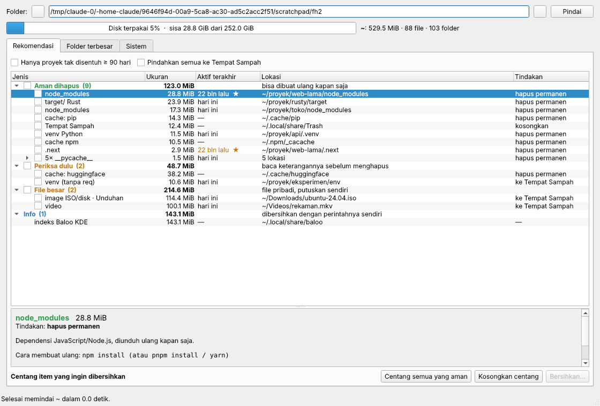

# sapu — penyapu penyimpanan untuk Linux

Cari tahu apa yang memenuhi disk, lalu bersihkan yang **aman dihapus**:
`node_modules`, venv Python, `target/` Rust, cache build, cache aplikasi, Tempat Sampah, dan lainnya.

Ada tiga cara memakainya, dengan mesin pemindai yang sama:

| Tampilan | Perintah | Cocok untuk |
|---|---|---|
| **GUI** (jendela Qt, tema KDE) | `sapu gui` atau menu aplikasi → *sapu* | sehari-hari, klik & centang |
| **TUI** (terminal interaktif) | `sapu tui` | di Konsole, lewat SSH, tanpa mouse |
| **CLI** (laporan teks) | `sapu`, `sapu clean`, `sapu system` | cepat, bisa dipakai dalam skrip |



## Instalasi

```bash
git clone https://github.com/furqonaugust17/sapu.git
cd sapu
./install.sh
```

Untuk memperbarui: `git pull` di folder itu, lalu jalankan `./install.sh` lagi.

Installer hanya memasang untuk user Anda (`~/.local`), lalu:
1. menyalin program ke `~/.local/share/sapu/`,
2. memeriksa pustaka Qt untuk GUI. Di Ubuntu/Kubuntu 24.04 ke atas, installer menawarkan
   `sudo apt install python3-pyqt6`, yang memakai Qt sistem sehingga tema Breeze dan ikon KDE ikut terpakai.
   Di versi lama (22.04), ia menawarkan venv berisi PySide6 (unduhan ±100 MB),
3. membuat perintah `sapu` di `~/.local/bin`,
4. menambahkan **sapu** ke menu aplikasi KDE (klik kanan ikonnya untuk membuka versi terminal).

CLI dan TUI tidak butuh apa pun selain Python 3 bawaan Ubuntu. Hapus semuanya dengan `./install.sh --uninstall`.

## GUI

- **Rekomendasi**: daftar bercentang yang dikelompokkan menjadi *Aman dihapus*, *Periksa dulu*, *File besar*, dan *Info*.
  Klik sebuah baris untuk melihat penjelasan dan cara membuatnya ulang. Klik dua kali untuk membuka lokasinya di Dolphin,
  dan klik kanan untuk menyalin jalur atau memindai folder proyeknya.
- **Folder terbesar**: pohon folder dengan bar porsi. Klik dua kali untuk memindai lebih dalam; tombol ↑ untuk kembali.
- **Sistem**: pemakaian tiap partisi serta sampah apt, journal, snap, flatpak, dan docker. Perintahnya bisa disalin
  atau dibuka langsung di Konsole (Anda tetap mengetik sendiri kata sandi sudo).
- Pemindaian berjalan di latar belakang dan bisa dibatalkan kapan saja. Sebelum menghapus, selalu ada dialog konfirmasi
  yang merinci apa yang dihapus permanen dan apa yang dipindah ke Tempat Sampah.

## TUI

| Tombol | Fungsi |
|---|---|
| `↑ ↓` `j k` `PgUp PgDn` | pindah baris |
| `Tab` / `1 2 3` | Rekomendasi · Folder terbesar · Sistem |
| `Spasi` | centang / batal centang |
| `a` | centang semua yang aman |
| `c` atau `Delete` | bersihkan yang dicentang (ada konfirmasi) |
| `f` | hanya proyek yang tak disentuh ≥ 90 hari |
| `t` | paksa semua ke Tempat Sampah |
| `Enter` / `←` | (tab Folder) pindai folder itu / kembali |
| `o` | buka lokasi di Dolphin |
| `y` | (tab Sistem) salin perintah ke clipboard (lewat Klipper KDE) |
| `r` · `?` · `q` | pindai ulang · bantuan · keluar |

## CLI

```bash
sapu                          # pindai home, tampilkan laporan
sapu ~/proyek                 # pindai folder tertentu
sapu clean                    # pilih nomor, misal "1 3 5-8" atau "aman"
sapu clean --older-than 90    # hanya proyek yang tidak disentuh >= 90 hari
sapu clean --dry-run          # simulasi, tidak menghapus apa pun
sapu system                   # sampah sistem: apt, journal, snap, flatpak, docker...
sapu scan --json              # data mentah untuk skrip lain
```

Opsi lain: `--min-size 50M`, `--min-file 500M`, `--trash`, `--permanent`, `--select '1-3' --yes`, `--rescan`.

## Apa yang dideteksi

| Kategori | Contoh | Status |
|---|---|---|
| Dependensi proyek | `node_modules`, venv (ada `pyvenv.cfg` + requirements/pyproject), `vendor/` Composer, deps Elixir | aman |
| Hasil build | `target/` (Cargo/Maven), `build/` (Gradle, Flutter, CMake, Python), `.next` `.nuxt` `.svelte-kit` `.turbo`, `.dart_tool`, `.terraform` | aman |
| Cache tool | `__pycache__`, `.pytest_cache`, `.mypy_cache`, `.ruff_cache`, `.tox` | aman |
| Cache home | isi `~/.cache`, `~/.npm/_cacache`, store pnpm, `~/.gradle/caches`, `~/.cargo/registry`, `~/go/pkg/mod`, cache VS Code | aman |
| Tempat Sampah | `~/.local/share/Trash` (dikosongkan, bukan dihapus foldernya) | aman |
| Perlu dicek | venv **tanpa** requirements, env conda, `dist/`, `~/.m2`, model Hugging Face, versi lama nvm/pyenv/rustup | periksa |
| File besar | ISO, AppImage, arsip, video, disk VM (≥ 100 MiB) | periksa → ke Tempat Sampah |
| Hanya info | `.git` raksasa, indeks Baloo KDE, emulator Android, model Ollama | ditampilkan beserta perintah resminya |

★ / "tidak aktif" berarti proyeknya tidak disentuh ≥ 90 hari, yaitu kandidat utama untuk dibersihkan.

## Pengaman

- Folder hanya ditandai bila **penanda proyeknya ada**: `target/` harus bersebelahan dengan `Cargo.toml`/`pom.xml`,
  `build/` harus punya `build.gradle`/`pubspec.yaml`/`CMakeCache.txt`, dan seterusnya. Folder `build` biasa di Dokumen tidak disentuh.
- Tepat sebelum menghapus, setiap folder **dicek ulang**. Jika penandanya hilang, berubah jadi symlink, berada di luar
  folder yang dipindai, atau merupakan folder penting (`~`, `~/.config`, `/usr`, dll.), folder itu dilewati.
- venv / Node / Python yang **sedang aktif** di sesi Anda tidak dihapus.
- Symlink tidak pernah diikuti, hardlink dihitung sekali, dan pemindaian tidak menyeberang ke partisi lain kecuali diminta.
- Yang bisa dibuat ulang dihapus permanen agar ruang langsung lega. Yang mungkin berisi data pribadi (file besar,
  venv tanpa requirements, `dist/`) dipindah ke **Tempat Sampah** dan bisa dipulihkan dari Dolphin.
- Perintah `sudo` untuk sampah sistem tidak pernah dijalankan diam-diam.

## Struktur kode

| File | Isi |
|---|---|
| `sapu.py` | mesin pemindai, aturan deteksi, pembersihan, dan CLI. API: `scan_path()`, `process_candidate()`, `system_items()` |
| `sapu_tui.py` | TUI (curses, tanpa dependensi) |
| `sapu_gui.py` | GUI (PyQt6 atau PySide6) |
| `install.sh` | installer per-user + entri menu KDE |

Menambah aturan sendiri: daftarkan dengan `_rule(...)` di `sapu.py`, lalu kenali polanya di `classify()`.
GUI dan TUI otomatis ikut menampilkannya.
